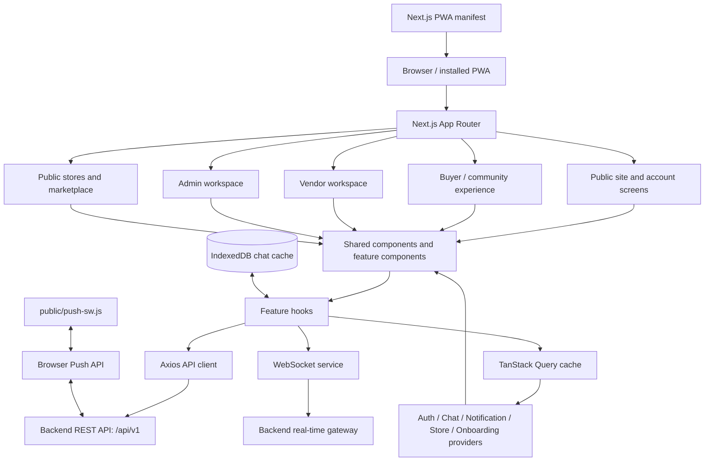

# Bouwnce Frontend

**Product and engineering documentation**  
**Source review date:** 10 October 2026

Bouwnce is a web application whose frontend brings together campus/community discovery, messaging, events, commerce, vendor storefront management, and administrative operations. This README is intended to help engineers, product owners, designers, operations staff, and prospective investors understand what the frontend contains, how it is structured, how it connects to backend services, and what should be verified before making production or business claims.

> **Scope and evidence note:** This document describes the code in the supplied `app/` and `public/` source tree. The supplied source archive did not include `package.json`, a lockfile, TypeScript/Next.js configuration, test configuration, or an `.env.example`. Exact dependency versions and runnable package scripts therefore cannot be confirmed from that snapshot. This is frontend documentation, not a guarantee that every feature is enabled in every deployed environment; backend permissions, persistence, payments, delivery guarantees, and operational status must be confirmed against the deployed services.

---

## 1. Executive overview

### What Bouwnce does

The frontend presents Bouwnce as a connected platform with several related experiences:

- **Discover and connect:** user discovery, interest selection, profiles, connection requests, and location-assisted discovery.
- **Communicate:** one-to-one conversations, text and media messages, replies, typing/online state, read/delivery updates, unread counts, and notifications.
- **Participate in events:** event discovery, event details, creation/editing, host management, attendance, tickets, and checkout-related screens.
- **Buy and browse:** a marketplace, product details, a cart, and public store pages.
- **Sell and operate a store:** vendor setup, store profile/branding, products, customers, orders, analytics, shipping, and wallet views.
- **Operate the platform:** administration views for overview metrics, users, vendors, waitlist entries, direct-message broadcasts, and newsletters.
- **Stay engaged:** browser push notifications, installable PWA behavior, in-app notification history, and connection status feedback.

The modules share an account/session layer and common API/query infrastructure. They are separate experiences inside one frontend application, rather than independently deployed frontend applications in this source tree.

### How to read this document

- **Business and product readers:** start with Sections 1–3 and the route map.
- **Frontend engineers:** read Sections 4–11 for architecture, providers, state, API integration, and feature flows.
- **Backend engineers:** read the API, authentication, WebSocket, and push sections to understand the contracts the frontend expects.
- **Security/release owners:** review the checklist and known verification items near the end.

---

## 2. Product areas and current frontend scope

| Product area | Frontend responsibilities visible in the source | Main routes |
|---|---|---|
| Public website | Landing-page sections, product overview, public navigation, waitlist form | `/`, `/waitlist` |
| Account access | Registration, login, email verification/OTP screens, authentication state | `/register`, `/login`, `/email_verification` |
| Buyer/community app | Discovery home, search, interests, profiles, connection requests, feed, chat | `/app`, `/app/explore`, `/app/profile`, `/app/feeds`, `/app/chat`, `/app/requests` |
| Events | Browse/detail/create/edit/manage events, attendance/ticket screens, payment and success screens | `/app/events…` |
| Marketplace | Product browsing/detail and cart/checkout initiation | `/marketplace`, `/marketplace/products/[productId]`, `/marketplace/carts` |
| Public storefronts | Store discovery and store detail pages | `/stores`, `/stores/[storeId]` |
| Vendor operations | Vendor onboarding/setup, store management, wallet, orders, customers, analytics | `/vendor…` |
| Platform administration | Overview, users, vendors, waitlist, admin messaging, newsletter editor and broadcasts | `/admin…` |
| Engagement/PWA | Notification panel, push subscription management, app install prompt, last-route restoration, connection toasts | Global components; manifest and service worker |

**Important boundary:** The frontend initiates requests and presents server responses. It does not establish, by itself, that the server authorizes a user, persists a transaction, successfully processes a payment, delivers a push notification, or calculates authoritative business metrics. Those guarantees belong to backend services and production operations.

---

## 3. Architecture at a glance



### Architectural principles visible in the code

1. **App Router organizes the product.** Route groups separate authentication, buyer/community, vendor, admin, and public-store layouts without necessarily appearing in the URL.
2. **Feature hooks own server-data interactions.** Hooks such as `use-chat`, `use-events`, `use-store`, and `use-product` wrap REST calls with TanStack Query queries and mutations.
3. **TanStack Query is the server-state cache.** It manages loading, retries, pagination, optimistic updates, cache invalidation, and shared data between components.
4. **Context provides cross-screen client state.** Authentication, chat UI state, notification counts, store/cart summary, and onboarding controls are shared through React context providers.
5. **Real-time chat uses a separate WebSocket transport.** Incoming events update the query cache so the conversation list and open message thread can stay in sync.
6. **The browser provides local capabilities.** IndexedDB stores chat-related local data; the service worker handles Web Push events; the manifest enables installable PWA behavior.
7. **The backend remains authoritative.** Role checks and UI routing are for user experience. Every protected endpoint and business operation must also be authorized and validated by the backend.

---

## 4. Technology stack

The supplied source imports or uses the following technologies. Exact versions are not available in the supplied archive.

| Technology | Purpose in this frontend |
|---|---|
| Next.js App Router | Route hierarchy, layouts, metadata, manifest, navigation, loading and not-found pages |
| React + TypeScript | Component model, typed feature code, context, hooks, and UI state |
| TanStack Query | API query/mutation lifecycle, pagination, caching, prefetching, and cache updates |
| Axios | Shared REST client with request/response interceptors and refresh handling |
| WebSocket / `reconnecting-websocket` | Real-time chat, typing/online state, acknowledgements, and reconnect behavior |
| Dexie / IndexedDB | Per-user local chat database for messages, conversations, and user data |
| React Hook Form | Form state/validation in form-heavy flows |
| Framer Motion | UI transitions and animation |
| React Quill (`react-quill-new`) | Newsletter rich-text editing |
| `driver.js` | Guided onboarding tour |
| `react-toastify` | Global toast notifications |
| `lucide-react` and `react-icons/*` | UI iconography |
| Browser Web Push and Service Worker APIs | Push subscription and background notification handling |
| CSS and utility classes | Global styling, responsive layouts, and component presentation |

The imported `next/image`, `next/link`, and `next/navigation` APIs are used across pages and components. The source also includes local media, icons, formatting helpers, date utilities, and shared TypeScript types.

---

## 5. Repository layout

```text
.
├── README.md
├── public/
│   └── push-sw.js                    # Web Push event and click handling
└── app/
    ├── layout.tsx                    # Root layout, metadata, global providers
    ├── page.tsx                      # Public landing page
    ├── manifest.ts                   # PWA manifest
    ├── globals.css                   # Global styling
    ├── (auth)/                       # Login, registration, verification UI
    ├── (dashboard)/
    │   ├── app/                      # Buyer/community product
    │   ├── admin/                    # Administration tools
    │   └── vendor/                   # Seller operations workspace
    ├── (store)/                      # Public storefront routes
    ├── marketplace/                  # Marketplace, product details, cart
    ├── waitlist/                     # Waitlist experience
    ├── _components/                  # Shared and public-facing UI components
    ├── context/                      # Global React contexts/providers
    ├── hooks/                        # Feature data hooks and behavior hooks
    ├── services/                     # API, auth refresh, query client, WebSocket, push
    ├── protocols/                    # Route guard, navigation redirect, portal helper
    ├── store/                        # Local persistence stores (including chat DB)
    ├── helpers/                      # Discovery/profile/database-sync helpers
    ├── _utils/                       # Formatting, metadata, types, notifications, utilities
    └── assets/                       # Logos, illustrations, icons, images
```

### Key files

| File | Responsibility |
|---|---|
| `app/layout.tsx` | Root HTML, global stylesheet, metadata, viewport, and `AppProvider` |
| `app/context/AppProvider.tsx` | Composes global providers, push/install behavior, socket connection wrapper, and toast container |
| `app/context/AuthContext.tsx` | Loads persisted session, updates user/session state, refreshes access tokens, and logs out |
| `app/services/api.ts` | Shared Axios instance configured for the backend API |
| `app/services/axios-client.ts` | Axios interceptors, access-token refresh gate, request blocking and retry backoff |
| `app/services/auth.ts` | Refresh-token HTTP call |
| `app/services/query-client.ts` | Shared TanStack Query client defaults |
| `app/services/websocket.ts` | Reconnecting WebSocket transport, event handlers, ping/pong, outbound queue |
| `app/hooks/use-chat.ts` | Conversation/message queries, prefetching, optimistic sends, media upload flow |
| `app/hooks/use-socket.ts` | Maps real-time chat events into query cache and UI state |
| `app/context/NotificationContext.tsx` | Notification list, total unread count, and conversation unread tracking |
| `app/_components/PushNotificationManager.tsx` | Service-worker registration and browser push subscription lifecycle |
| `app/manifest.ts` | PWA identity, icons, display mode, and protocol handler metadata |
| `app/protocols/SecureRoutes.tsx` | Frontend route redirects and role checks |
| `app/store/chat-store.ts` | Per-user IndexedDB database definitions and migrations |
| `app/context/OnboardingProvider.tsx` | Profile completeness gate and guided-tour state |

---

## 6. Route map

Route groups in parentheses, such as `(auth)` and `(dashboard)`, are organizational and do not appear in the browser URL. Dynamic segments in square brackets are filled with record IDs.

### Public and account routes

| Route | Purpose |
|---|---|
| `/` | Marketing/landing page composed of hero, about, explore, and footer sections |
| `/waitlist` | Waitlist signup and waitlist insight UI |
| `/register` | Account registration |
| `/login` | Sign in |
| `/email_verification` | Email verification / OTP flow |
| `/marketplace` | Marketplace product discovery |
| `/marketplace/products/[productId]` | Product detail |
| `/marketplace/carts` | Cart and checkout initiation |
| `/stores` | Public store discovery |
| `/stores/[storeId]` | Public store detail |
| `/chat` | Redirects to `/app/chat` |

### Buyer/community routes

| Route | Purpose |
|---|---|
| `/app` | Authenticated home/discovery experience |
| `/app/explore` | Explore/search and connection discovery |
| `/app/feeds` | Social feed |
| `/app/feeds/[postId]` | Post detail |
| `/app/feeds/[postId]/comment/[commentId]` | Comment detail |
| `/app/chat` | Conversation list and messaging UI |
| `/app/chat/[chatId]` | Conversation route for a selected chat |
| `/app/requests` | Connection requests |
| `/app/profile` | Current user's profile |
| `/app/profile/[userId]` | A user's public/profile view |
| `/app/events` | Event discovery/listing |
| `/app/events/create` | Event creation |
| `/app/events/[eventId]` | Event details |
| `/app/events/[eventId]/edit` | Event editing |
| `/app/events/manage` | User's event management list |
| `/app/events/manage/[eventId]` | Management view for an event |
| `/app/events/ticket` | Ticket-related route, with an intercepted modal route used for in-app navigation |
| `/app/events/[eventId]/payment` | Event payment/checkout UI |
| `/app/events/[eventId]/payment/success` | Payment success screen |

### Vendor routes

| Route | Purpose |
|---|---|
| `/vendor/setup` | Vendor/store setup flow |
| `/vendor/store` | Store configuration and profile/branding management |
| `/vendor` | Vendor dashboard overview |
| `/vendor/wallet` | Wallet summary and related controls |
| `/vendor/orders` | Order management |
| `/vendor/customers` | Customer management |
| `/vendor/analytics` | Store analytics |

### Admin routes

| Route | Purpose |
|---|---|
| `/admin` | Admin route entry |
| `/admin/overview` | Platform overview/dashboard |
| `/admin/users` | User administration |
| `/admin/vendors` | Vendor administration |
| `/admin/waitlist` | Waitlist administration |
| `/admin/messages` | Admin direct messaging/broadcast UI |
| `/admin/newsletter` | Newsletter management, editing, and broadcast UI |

Route availability in code does not by itself prove that a screen is enabled or accessible in a particular deployment. The backend must enforce access policy independently of frontend routing.

---

## 7. Global application composition

`app/layout.tsx` wraps the rendered route tree in `AppProvider`. The current provider composition in `app/context/AppProvider.tsx` is:

1. **`QueryClientProvider`** — shares the TanStack Query client.
2. **`AuthProvider`** — restores and manages the user session.
3. **`PWARestore`** — remembers the most recent `/app` route and can restore it when an installed PWA is opened at `/` by a signed-in user.
4. **`ChatProvider`** — holds selected-chat, typing, online-user, reply, upload, and conversation warm-up state.
5. **`NotificationProvider`** — combines chat and system unread counts and maintains notification cache helpers.
6. **`PushNotificationManager`** — registers `public/push-sw.js` and manages push permission/subscription.
7. **`InstallApp`** — app-install prompting behavior.
8. **`ChatResetBridge`** — connects authentication/session reset to chat state cleanup.
9. **`StoreProvider`** — exposes cart summary/loading state to descendants.
10. **`OnboardingProvider`** — exposes profile-completion and guided-tour behavior.
11. **`SocketConnect`** — connects the real-time socket for the signed-in user and renders connection/auth-related UI.
12. **`ToastContainer`** — shared toast presentation.

The provider order matters: components consuming auth, query, chat, and notification contexts must be rendered below the corresponding providers. Keep future providers near the domain that owns their state and avoid duplicate global instances.

---

## 8. API access and server-state management

### REST client

`app/services/api.ts` creates the shared Axios instance:

- Base URL: `${NEXT_PUBLIC_API_URL}/api/v1`
- Request timeout: 60 seconds
- `withCredentials: true`, so cookie-based refresh requests can use browser credentials

Use this client for authenticated API operations so the auth interceptors and common configuration are applied. A separate `fetchClient` helper exists for simple `fetch` calls; it returns `null` for non-OK responses rather than throwing, so callers must explicitly handle `null`.

### TanStack Query defaults

The shared client in `app/services/query-client.ts` sets:

- Default query `staleTime`: 5 minutes
- Default query retry: 2 retries
- `refetchOnWindowFocus`: disabled by default

Feature hooks can override these defaults. Infinite queries are used for paginated conversations, messages, notifications, events, discovery, and other collections. Mutations generally invalidate or directly update relevant cache keys after writes.

### Feature-hook domains

| Hook | Main responsibility |
|---|---|
| `use-authservices.ts` | Login, registration, profile update, OTP/verification, logout actions |
| `use-user.ts` | User profile, updates, account actions, profile-image upload |
| `use-chat.ts` | Conversation/message queries, optimistic messaging, media signing/upload |
| `use-socket.ts` | Real-time WebSocket event processing and cache updates |
| `use-notification.ts` | Notifications, unread summary, mark-read operations, push subscription endpoints |
| `use-events.ts` | Event browse/detail/manage/create/update/delete/attendance/status flows |
| `use-interest.ts` | Available/user interests and updates |
| `use-match.ts` | Suggested matches, connection requests, matches, parsed search |
| `use-product.ts` | Product and product-category operations |
| `use-cart.ts` | Cart reads/writes and checkout initiation |
| `use-store.ts` | Store info, branding, contacts, payout configuration, onboarding status, store search |
| `use-shipping.ts` | Shipment queries and mutations |
| `use-vendor.ts` | Vendor dashboard and wallet summary |
| `use-admin.ts` | Admin direct-message broadcast |
| `use-waitlist.tsx` | Waitlist signup and listing |
| `useNewsletter.ts` | Newsletter list/detail/create/update/delete/broadcast |
| `useGeneratedHtml.ts` | Debounced newsletter HTML generation |
| `useEventDraft.ts` | Event-form draft persistence helper |
| `use-location.ts` | Current-user location sync |

### API families observed in the source

Endpoint names below are examples found in hooks/services, not a complete API contract:

- **Authentication:** `/auth/refresh-token` and login/registration/verification flows.
- **Users and profiles:** `/users/me`, `/users/carts/*`, user profile and profile-image operations.
- **Chat:** `/chats/conversations`, `/chats/conversations/with/:userId`, `/uploads/chat/sign`.
- **Notifications and push:** `/notifications`, `/events/unread`, `/push/vapid-public-key`, `/push/subscribe`, `/push/test`.
- **Events:** `/outgoing/events/events/*` and event attendance/status routes.
- **Connections/discovery:** `/interests/*`, `/matches/*`, `/search/parse`, `/location/me`.
- **Commerce/store:** product, cart, store, shipment, vendor dashboard, and wallet endpoints.
- **Administration:** `/admin/bouwnce/messages`, waitlist routes, and newsletter routes.

The backend remains the source of truth for identifiers, permission decisions, monetary amounts, order status, payment status, and persisted content.

---

## 9. Authentication, token refresh, and logout

### Session model in the current source

- `AuthProvider` loads a serialized session from local storage key `bouwnceUser` during initialization.
- The serialized object includes the current access token and user data used by the UI.
- The refresh request is sent to `/api/v1/auth/refresh-token` with credentials enabled; the source comments indicate refresh relies on cookies.
- The API client reads the current access token from the auth provider and adds it as a Bearer token to protected API requests.
- The WebSocket connects using `NEXT_PUBLIC_WS_URL` with the access token in the connection URL query parameter.
- Logout clears the in-memory auth state and query cache, removes `bouwnceUser` and `ws_token`, resets registered chat state, and disconnects the WebSocket.

### Refresh behavior

The current refresh implementation distinguishes an invalid session from a temporary inability to refresh:

1. When an access token is expired or close to expiry, the client attempts refresh before the protected request is sent.
2. Parallel refresh attempts for the same access token share one in-flight promise.
3. Invalid refresh/auth responses (`400`, `401`, `403`) or a successful response without an access token are treated as an expired session and trigger local logout.
4. Connectivity or server failures are treated as temporary. The old token is blocked from use for protected requests while refresh is unavailable.
5. Retry delay increases from 1 second up to 30 seconds; the browser `online` event can trigger an immediate recovery attempt.
6. A refresh result from an earlier session must not overwrite a later login/logout session.
7. A protected request rejected by the refresh gate is not sent with the stale token.

Public registration/OTP-related calls are exempted from this specific refresh gate so that pre-login flows can still function.

### Security notes for engineering review

- The current frontend stores the access token inside serialized local storage. Assess the XSS threat model and whether an access-token-in-memory or secure-cookie model is appropriate for the production identity architecture.
- The WebSocket token is placed in a query parameter by the current transport. Confirm server/proxy logging does not persist credential-bearing URLs and consider the gateway's supported authentication alternatives.
- Frontend guards improve navigation and user experience; **backend authorization is mandatory** for all admin, vendor, user, event, wallet, store, and order endpoints.
- Do not place secrets in variables prefixed with `NEXT_PUBLIC_`; those values are exposed to the browser bundle.

---

## 10. Real-time chat and local cache

Chat is one of the more stateful frontend areas. It combines REST history, TanStack Query cache, a reconnecting WebSocket, optimistic local UI updates, and a per-user IndexedDB database.

### Message lifecycle

1. After authentication, `ChatProvider` warms the first page of the conversation list.
2. Conversation cards can prefetch the newest message page before a conversation is opened.
3. Message history uses an infinite query with a default page size of 20. The first page represents the newest messages; older pages are fetched as needed.
4. When a user sends a text message, the UI creates a temporary optimistic message and updates message and conversation caches immediately.
5. The socket sends a `chat.send` event. Server acknowledgements reconcile temporary messages and delivery state.
6. Incoming `chat.message` events update the message cache and move the corresponding conversation toward the top of the list.
7. Typing, online snapshots/updates, read updates, and delivery acknowledgements update their related UI/cache state.
8. Incoming messages that are not already present and are not in the active conversation can generate in-app notification/toast state.

### Real-time event names handled by the current client

- `chat.message`
- `chat.sent`
- `chat.send.ack`
- `chat.typing`
- `chat.read.updated`
- `chat.read.ack`
- `user.online`
- `user.online.snapshot`

The client emits `chat.send` and `chat.upload_media` events. These names are a frontend/backend contract: changing them on either side requires coordinated updates.

### Local persistence and cache policy

- `app/store/chat-store.ts` uses Dexie to create a database named `chat_db_<userId>`.
- The database declares `messages`, `conversations`, and `users` tables with indexes and migration logic for `peer_id`.
- Message queries use a 5-minute stale time and a 30-minute garbage-collection time; mount/window-focus/reconnect refetches are disabled for that query to avoid unnecessary duplicate network loads.
- Optimistic IDs / `client_id` are used to match server acknowledgements to messages created locally.
- A pending-message recovery hook exists in `usePendingMesssageRecovery.tsx`.

These mechanisms support fast conversation opening and local state recovery. They should not be described as a guarantee of full offline messaging unless the API protocol, upload flow, background synchronization, and device-level behavior have been end-to-end tested.

### Media

The client requests a signed upload payload from `/uploads/chat/sign`, then uploads media directly to Cloudinary using the returned signing fields. The application API is involved in issuing the upload signature; the actual binary upload uses a direct Cloudinary URL.

---

## 11. Notifications and installable PWA

### In-app notifications

`NotificationProvider` combines the system unread count with unread conversation counts and exposes notification data, mark/read helpers, pagination, and connection-modal state. Notification pages use an infinite query with a page size of 20. The cache is updated locally when notifications arrive or are marked read.

### Web Push lifecycle

`PushNotificationManager`:

1. Registers `/push-sw.js` with service-worker update checks.
2. Obtains the VAPID public key from `/push/vapid-public-key`.
3. Requests notification permission from a user action where required.
4. Creates or reuses a browser `PushSubscription` and posts it to `/push/subscribe`.
5. Avoids re-syncing the same endpoint repeatedly using an in-memory ref and local storage key `bouwnce:push:synced-endpoint`.
6. On explicit disable, asks the backend to remove the subscription and unsubscribes the browser subscription.

### Background notification behavior

`public/push-sw.js` handles the push event, extracts the payload, chooses a notification title/body/tag, displays the notification, and opens or focuses a Bouwnce window when clicked. Chat payloads can provide `data.sender_profile_image` as either a URL string or an object with a `url` property; `data.sender_profile_image_url` is also supported by the updated source. The sender image is used as the main notification icon and as the larger image where supported. The Bouwnce app icon remains the badge/fallback.

**Backend contract for chat pushes:** include a publicly reachable HTTPS sender-avatar URL. Browser and operating-system support for large notification images differs, so the main icon is the more broadly used surface while `image` is an enhancement.

### PWA behavior

- The manifest uses Bouwnce as the application name, standalone display mode, portrait orientation, and icon variants for standard/maskable install surfaces.
- A `web+bouwnce` protocol handler is declared.
- `PWARestore` saves the most recent `/app` route with its query and hash under `bouwnce_last_app_route` and attempts to restore it for an authenticated user opening `/`. Verify the installed-PWA-only condition before relying on the restore being limited to installed launches: the current source defines a standalone-detection helper but does not call it in the restore effect.
- The PWA install prompt and push-notification prompt are separate behaviors.

The supplied source demonstrates PWA installation, route restoration, and push wiring. It does not show a complete offline page/data caching strategy, so avoid describing the frontend as fully offline-first based on this code alone.

---

## 12. Events, marketplace, stores, and vendor operations

### Events

The event area contains discovery/listing, details, creation/editing forms, locally restorable event drafts, management pages, attendance/ticket components, payment UI, and a payment success route. Hook operations include creating/updating/deleting events, attending/cancelling attendance, and changing event status. Ticket/payment completion must be validated with backend/payment-provider contracts; the frontend route alone is not proof of settlement.

### Marketplace and carts

The marketplace includes product browsing, product detail pages, cart reading and mutation, shipping information, and a checkout initiation mutation. Product hooks also expose product/category operations used by commerce/store pages.

### Public stores and vendor workspace

Public pages browse stores and show store details. The vendor area supports onboarding/setup, own-store data, store branding, contacts, payout configuration, products, shipping records, orders, customers, analytics, and wallet summary views. Exact capabilities and permitted actions depend on the backend response and user role.

### Admin workspace

Admin pages cover platform overview, user/vendor review, waitlist management, support/direct messages, and newsletter creation/editing/broadcast. Newsletter HTML generation is debounced by 350 ms so the preview does not rebuild on every keystroke.

---

## 13. Configuration and local development

### Environment variables identified in the source

Create a local `.env.local` in the complete application repository. Values below are placeholders; use the correct environment-specific hosts and do not commit credentials.

```dotenv
# Backend origin only; code appends /api/v1
NEXT_PUBLIC_API_URL=https://api.example.com

# WebSocket origin/path provided by the backend real-time gateway
NEXT_PUBLIC_WS_URL=wss://api.example.com/realtime

# Canonical app origin used by the PWA manifest
NEXT_PUBLIC_APP_URL=https://app.example.com

# Base host used by at least one profile-image URL construction
NEXT_PUBLIC_BASE_URL=https://app.example.com
```

| Variable | Use in the source | Required for |
|---|---|---|
| `NEXT_PUBLIC_API_URL` | Axios API base and refresh-token endpoint | REST API interactions |
| `NEXT_PUBLIC_WS_URL` | WebSocket connection URL | Real-time chat/online state |
| `NEXT_PUBLIC_APP_URL` | Manifest origin/related web-app metadata | Correct production PWA metadata |
| `NEXT_PUBLIC_BASE_URL` | Base URL concatenation for a profile image in marketplace UI | The affected profile-image URL flow |

The WebSocket value's exact path depends on the deployed gateway and should not be copied from the example. Since `NEXT_PUBLIC_API_URL` is concatenated with `/api/v1`, configure it as an origin/base host rather than including `/api/v1` twice.

### Install/run/build commands

The supplied source archive does not contain `package.json` or a lockfile, so the actual package manager, dependency versions, and script names cannot be validated here. In the full repository:

1. Restore/retain the canonical `package.json` and lockfile from the project repository.
2. Install dependencies using that repository's package manager and lockfile.
3. Configure `.env.local` with the appropriate development API and WebSocket hosts.
4. Use the `dev`, `build`, `start`, `lint`, and test scripts that are actually declared in `package.json`.
5. Confirm service-worker behavior on HTTPS or localhost, since browsers restrict Service Worker/Web Push features to secure contexts.

Do not create new dependency versions or package scripts from this README alone; keep them aligned with the project's actual manifest and CI pipeline.

---

## 14. Engineering conventions for ongoing work

- **Keep API calls in feature hooks/services.** Avoid embedding repeated request/response logic directly in components.
- **Use the shared Axios client** for standard backend calls so refresh protection and common configuration are applied.
- **Keep server state in TanStack Query.** Define stable query keys, update/invalidate the relevant cache after writes, and reuse prefetched data rather than issuing duplicate requests on route changes.
- **Clean up real-time listeners.** Every `websocket.on` subscription in a React effect should have a matching `websocket.off` cleanup.
- **Treat WebSocket events as an API contract.** Document payload shape, IDs, acknowledgements, duplicate handling, reconnect behavior, and read state when modifying events.
- **Separate user-specific local data.** Chat IndexedDB is scoped by user ID; logout/account switching must clear in-memory chat state and avoid leaking cached content across accounts.
- **Keep tokens and secrets out of logs.** Avoid logging complete auth payloads or tokens, including connection URLs.
- **Use accessible loading/error/empty states.** Route data can be unavailable due to network errors, stale sessions, permissions, or empty records.
- **Keep public and private route intent explicit.** Any route intended for public viewing should be deliberately listed and verified; a client-side redirect is not an authorization boundary.
- **Treat displayed amounts/statuses as server-provided data.** Checkout, payout, wallet, order, and ticket state must be validated server-side.
- **Review mock data before reporting metrics.** Static fixtures may be useful for layouts/demos but must not be presented as live production data without verification.

---

## 15. Production readiness and items to verify

The following items are based on the supplied code snapshot and should be checked in the full repository/deployment. They are not claims that the deployed system is necessarily broken.

1. **Build and test baseline:** add or confirm a reproducible CI job for install, lint, type-check, unit tests, and production build. Those configuration files were absent from the supplied source archive, so a full build could not be validated from it.
2. **Route authorization review:** `SecureRoutes.tsx` currently treats `/app/profile*` and `/app/events*` as public-route exceptions to its unauthenticated redirect. Confirm this matches product intent. Frontend page access must never replace server authorization.
3. **Vendor setup/store wrappers:** the vendor layout renders `/vendor/setup` and `/vendor/store` outside its regular `VendorLayout` wrapper, which is also where `SecureRoute` is applied. Confirm those pages are protected elsewhere and ensure their APIs reject unauthorized callers.
4. **Mock-backed UI values:** the admin layout's pending badge uses static `VENDORS` and `STORES` data imported from `app/_utils/mock.ts`. Review mock/dummy fixtures elsewhere before presenting values as live metrics.
5. **Onboarding persistence:** `OnboardingProvider` comments that no onboarding endpoint is currently exposed; tour completion is stored locally and updated in session memory. Decide whether server persistence is needed across devices.
6. **HTTP helper failure semantics:** `fetchClient` returns `null` on a non-OK response. Confirm callers handle that case or consider an explicit typed error contract.
7. **Token storage and WebSocket authentication:** assess local-storage token exposure and token-in-query-string handling as part of the application's threat model.
8. **PWA behavior and push contracts:** verify that route restoration is restricted to installed-PWA launches if that is the intended product behavior; test subscription lifecycle on supported browsers, ensure logout/device opt-out semantics match backend subscription ownership, and test sender-avatar URLs in real payloads. Notification image rendering varies by OS/browser.
9. **Payment/order boundaries:** document the backend/payment provider's authoritative states and callback/webhook behavior so frontend success pages cannot be treated as proof of payment by themselves.
10. **Environment alignment:** confirm development, staging, and production hosts for API, WebSocket, public media, and PWA origin. Ensure `NEXT_PUBLIC_*` values contain no secrets.
11. **Observability and privacy:** review console logs (including WebSocket connection logging), notification payload data, and error reporting before production release.
12. **Accessibility/mobile validation:** verify keyboard and screen-reader behavior, small-screen layouts, install flows, safe areas, media upload, and PWA restore paths on target devices.

---

## 16. Glossary

| Term | Meaning in this project |
|---|---|
| **App Router** | Next.js routing based on files and nested layouts under `app/` |
| **Context/provider** | React mechanism used to make shared session or UI state available to descendants |
| **TanStack Query** | Library managing server data, async request state, caching, and invalidation |
| **Optimistic message** | A message rendered before the server acknowledgement arrives, later reconciled with server state |
| **IndexedDB/Dexie** | Browser-local database and wrapper used to store chat-related data per user |
| **WebSocket** | Long-lived connection used for real-time chat and user-presence events |
| **Service worker** | Background browser script that receives push events and displays/click-handles notifications |
| **VAPID** | Keys used by Web Push to identify/authorize the application server for push subscriptions |
| **PWA** | Progressive Web App: web app with installable metadata and app-like launch behavior |
| **Frontend route guard** | UI navigation logic based on session/role; not a substitute for backend authorization |

---

## 17. Ownership and maintenance

For a code change, the most direct starting point is the feature's route/page and matching hook. Then check its shared context, API endpoint, type definitions, loading/error states, and cache invalidation behavior. For authentication, WebSocket, push, or provider changes, review the global integration points as well as the feature component.

Keep this README aligned with the real repository whenever routes, environment variables, endpoint contracts, role rules, provider ordering, storage, or deployment scripts change. Where the source does not establish a capability or operational guarantee, document it as **unverified** until it is confirmed through backend documentation and end-to-end tests.
